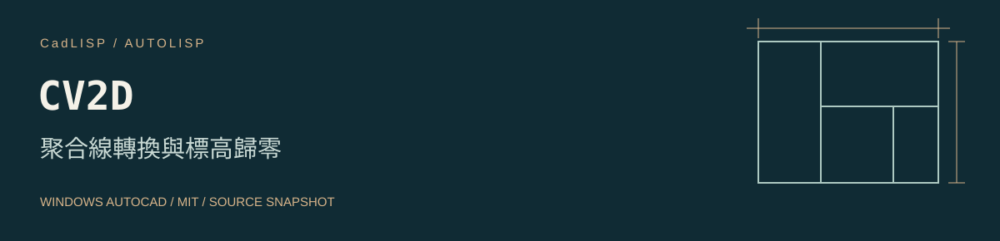

# CV2D 聚合線轉換與標高歸零



[工具儲存庫](https://github.com/whos-dwg/CadLISP-CV2D) · [全部工具索引](https://github.com/whos-dwg/CadLISP-Index)

嘗試將符合篩選的舊式 POLYLINE 轉成輕量聚合線，再把全圖 LWPOLYLINE 標高設為 0。

**使用前需處理：** 舊式 POLYLINE 篩選的旗標遮罩是 48，沒有排除 bit 8 的 3D polyline 及 bit 64 的 polyface mesh，可能將其送入 CONVERTPOLY。應修正過濾後驗證混合類型圖面。後續全圖 LWPOLYLINE 僅將 DXF 38 設為 0，不能當成完整 3D 壓平。[POLYLINE DXF 官方說明](https://help.autodesk.com/cloudhelp/2024/ENU/AutoCAD-DXF/files/GUID-ABF6B778-BE20-4B49-9B58-A94E64CEFFF3.htm)。

| 項目 | 內容 |
| --- | --- |
| 指令 | `CV2D` |
| 檔案 | [CV2D.LSP](lsp/CV2D.LSP) |
| 分類 | 幾何處理 |
| 狀態 | 有待修正的原碼問題 |
| 授權 | [MIT](LICENSE)，Copyright (c) 2026 whos-dwg |

[安裝](#安裝) · [操作](#操作) · [相依與設定](#相依與設定) · [已知問題](docs/KNOWN_ISSUES.md) · [驗證紀錄](docs/VALIDATION.md)

## 安裝

以 Windows 桌面版 AutoCAD 為目標。原碼使用的 Visual LISP／ActiveX、DCL 或原生命令，需在目標 AutoCAD 版本分別確認；尚未做整包年份、LT、Mac 或其他 CAD 的相容性認證。ActiveX 的平台限制見 [Autodesk](https://help.autodesk.com/cloudhelp/2026/ENU/AutoCAD-AutoLISP/files/GUID-A0459510-CE7A-4206-9EAA-E25AAB569B20.htm)。

1. 下載並解壓縮本工具到固定位置，先開啟測試圖面。
2. 依公司環境把 `lsp` 資料夾加入需要的支援搜尋路徑與受信任位置。
3. 輸入 `APPLOAD`，載入 `CV2D.LSP`；關閉視窗後輸入 `CV2D`。

也可使用完整路徑單獨載入；下列路徑需依實際位置修改：

```lisp
(load "C:/CAD/CadLISP-CV2D/lsp/CV2D.LSP")
```

完成驗證後，可將這支 LISP 加入 APPLOAD 的 Startup Suite。請維持既定的 SECURELOAD 政策，使用受信任位置處理載入限制。[SECURELOAD 說明](https://help.autodesk.com/cloudhelp/2026/ENU/AutoCAD-Core/files/GUID-541566C6-2738-49DD-87C3-C1490E924A02.htm)。

## 操作

1. 先另存測試副本。
2. 載入後輸入 `CV2D`；程式會直接以全圖選集處理，沒有逐一框選步驟。
3. 檢查轉換結果與所有輕量聚合線的 Elevation。

## 相依與設定

僅在圖面副本上操作，先確認哪些 LWPOLYLINE 必須保留標高。

圖面影響：全圖範圍修改；結束將 CMDECHO 設為 1。

## 行為與限制

原碼以旗標遮罩 48 篩選舊式 POLYLINE，未排除 DXF bit 8 的 3D polyline 及 bit 64 的 polyface mesh，不能視為可靠的純 2D 過濾。它只把 LWPOLYLINE 的 DXF 38 改為 0，不能宣稱把所有 3D 幾何完整壓平。

## 來源與授權

本工具依維護者確認為自行從零撰寫，或以 AI 協作從零開發。程式與本次文件採 [MIT 授權](LICENSE)，允許使用、修改與再散布，須保留授權及著作權聲明。詳細來源紀錄見 [provenance.json](metadata/provenance.json)。

## 回報與維護

回報時附 AutoCAD 完整版本、命令列錯誤與去識別的重現範例。修改前請閱讀 [CONTRIBUTING](CONTRIBUTING.md)；發行步驟見 [PUBLISHING](docs/PUBLISHING.md)。本工具可獨立維護、下載及發布，不依賴其他 CadLISP 工具儲存庫。
